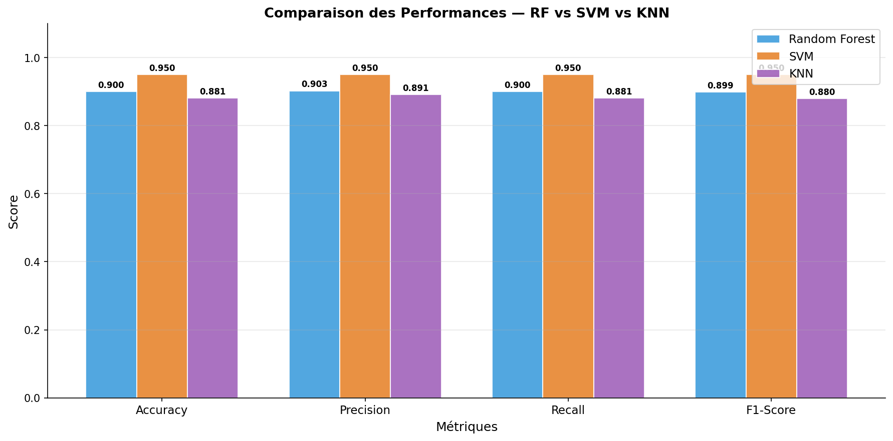
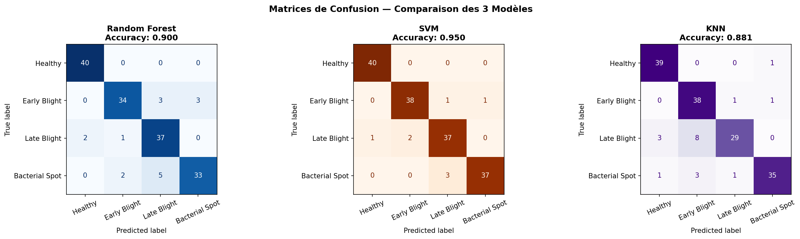

# 🍅 Tomato Leaf Disease Detector


Detects diseases on tomato leaves from a photo. The project compares **classical machine learning** (on handcrafted image features) with **deep learning** (MobileNetV2 transfer learning), then serves the models in an interactive **Gradio** web app.

Dataset: a subset of **[PlantVillage](https://www.kaggle.com/datasets/emmarex/plantdisease)** (not included in the repo, download it and place the 4 class folders at the root) with 4 classes: *Healthy*, *Early Blight*, *Late Blight*, *Bacterial Spot*.

## 📈 Results

| Model | Accuracy | Precision | Recall | F1-score |
|---|---|---|---|---|
| 🏆 **SVM** | **95.0%** | **95.0%** | **95.0%** | **95.0%** |
| Random Forest | 90.0% | 90.3% | 90.0% | 89.9% |
| CNN (MobileNetV2, transfer learning) | 88.8% | 88.8% | 88.8% | 88.6% |
| KNN | 88.1% | 89.1% | 88.1% | 88.0% |

> SVM on engineered features beat the CNN on this small dataset, a good reminder that model choice depends on data size.

<p align="center"></p>
<p align="center"></p>

## 🔬 Pipeline

1. **Pre-processing**: resize to 128×128, color conversion, denoising
2. **Segmentation**: isolate the leaf from the background
3. **Feature extraction**: color histograms + texture features (**GLCM**: contrast, homogeneity, energy…)
4. **Classical ML**: KNN, Random Forest, SVM with standardization and cross-validation
5. **Deep learning**: MobileNetV2 pre-trained on ImageNet, two-phase fine-tuning with early stopping
6. **Evaluation**: accuracy, precision, recall, F1, confusion matrices, radar comparison chart
7. **Deployment**: Gradio interface showing the prediction, severity and treatment advice

## 🚀 Run the app

```bash
git clone https://github.com/bechirrrr/tomato_detector.git
cd tomato_detector
pip install -r requirements.txt
python app_gradio2.py
```

Then open the local URL Gradio prints (usually http://127.0.0.1:7860) and upload a leaf photo.

## 📁 Project structure

```
tomato_detector/
├── plant_disease_classification.ipynb   # Full training & evaluation notebook
├── app_gradio2.py                       # Gradio web app
├── saved_models/                        # Trained models (SVM, RF, KNN, scaler, CNN weights)
└── outputs/                             # Charts: pre-processing, features, confusion matrices, comparison
```

## 👤 Author

**Bechir Marweni**: [LinkedIn](https://www.linkedin.com/in/bechir-marweni-790032279) · [GitHub](https://github.com/bechirrrr)
